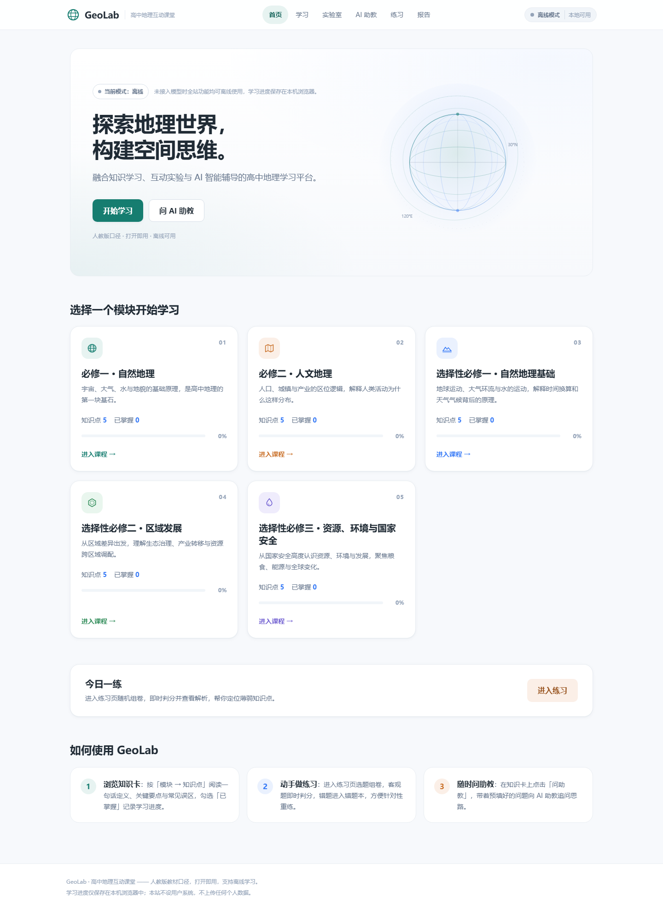
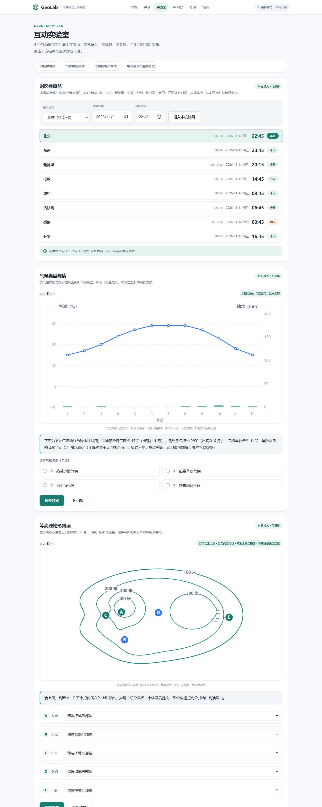
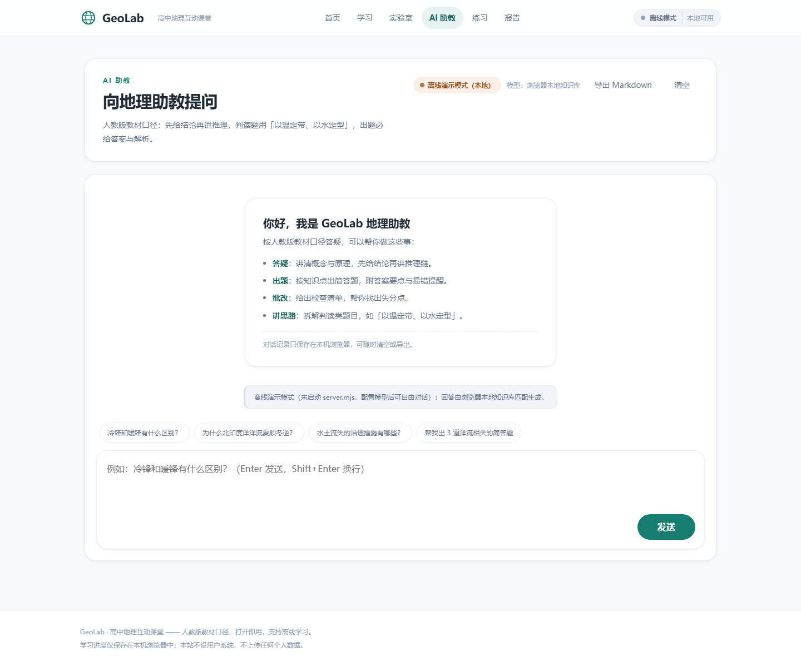
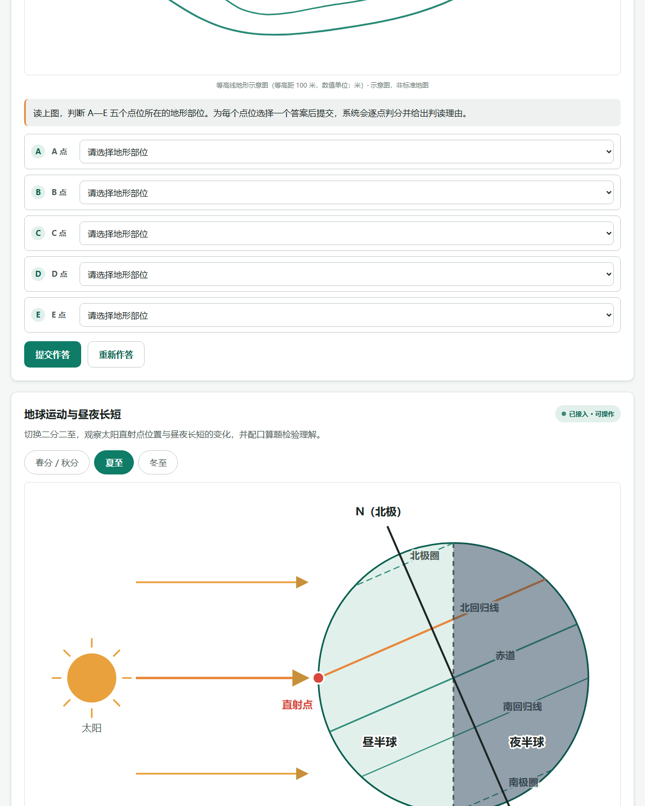
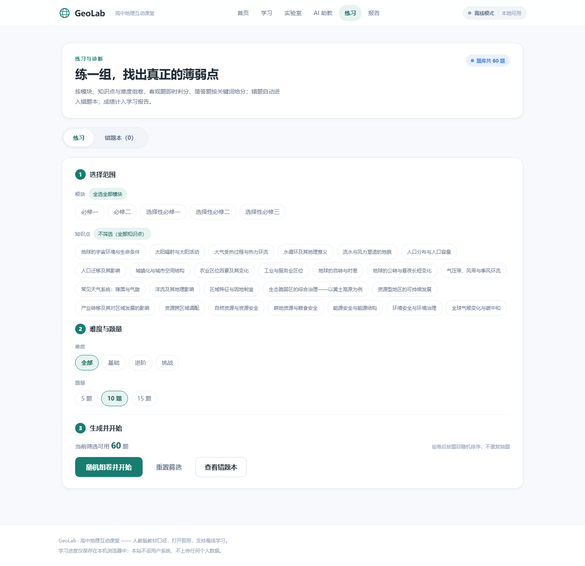

# GeoLab · 高中地理互动课堂

面向高中生的地理学习网站：按人教版口径整理的**知识卡地图 + 4 个互动演示 + 60 题练习诊断 + 可对话的 AI 地理助教**。整个网站是纯静态前端，**双击 index.html 打开即用、离线可学**；配置模型后，AI 助教按地理教师人设答疑、出题、批改。



## 快速开始

### 方式 A：零配置离线使用（推荐先试）

双击 `index.html` 即可。浏览知识卡、做互动演示、练习诊断、查看学习报告全部可用；AI 助教进入「离线演示模式」，用内置知识库按关键词回答，不联网。

### 方式 B：接入本机 TeleAgent 模型（本机、无需 API Key）

前提：本机已安装并运行 **TeleAgent 桌面版**（网站通过它的本地接口调用模型），且存在接管工具目录 `D:\DSH-Workspaces\teleagent-bridge`。

在项目目录执行：

```powershell
powershell -NoProfile -ExecutionPolicy Bypass -File .\start-server.ps1
```

脚本会确认 TeleAgent 后端在运行 → 自动获取本次运行期的本地会话密钥 → 以 `teleagent` 模式启动服务。浏览器打开 <http://127.0.0.1:8787> 即可真实对话（使用 TeleAgent 的账号与模型）。TeleAgent 重启后密钥会变化，重跑一次脚本即可。

### 方式 C：接入模型（OpenAI 兼容 API）

```powershell
$env:GEO_MODEL_MODE = 'openai'
$env:OPENAI_API_KEY = 'sk-...'
$env:OPENAI_BASE_URL = 'https://api.openai.com/v1'   # 可换成任意 OpenAI 兼容网关
$env:OPENAI_MODEL = 'gpt-4o-mini'
node server.mjs        # 或 PORT=8080 node server.mjs
```

然后浏览器打开 <http://127.0.0.1:8787>，AI 助教即可真实对话；顶栏与首页会显示「已接入模型」。

## 功能一览

| 视图 | 内容 |
| --- | --- |
| 首页 `#/home` | 学习地图（5 个模块进度）、今日一练、使用说明 |
| 学习 `#/learn` | 25 张知识卡：定义 / 关键要点 / 常见误区 / 典型案例，可标记「已掌握」；每模块有 4 个互动演示入口 |
| 实验室 `#/lab` | ① 时区换算器 ② 气候类型判读（以温定带、以水定型）③ 等高线地形判读 ④ 地球运动与昼夜长短（含口算题） |
| AI 助教 `#/tutor` | 流式对话、快捷提问、Markdown 渲染、会话本地保存、导出 Markdown、清空；支持离线降级 |
| 练习 `#/practice` | 按模块/知识点/难度组卷（5/10/15 题），单选/多选/判断/简答即时判分 + 解析，错题本、重练 |
| 报告 `#/report` | 练习次数、正确率、薄弱知识点 Top5、最近 10 次正确率趋势、学习建议 |






## 内容规模

- 知识卡：5 个模块（必修一、必修二、选择性必修一/二/三）× 5 个知识点 = **25 张**
- 题库：**60 题**（单选 30 / 多选 10 / 判断 10 / 简答 10），每题带解析与知识点标签
- 互动组件：**4 个**，全部原生 SVG 绘制，含判分与解析

## 模型接入契约（server.mjs）

- `GET /api/health` → `{ ok, mode, model }`
- `POST /api/chat`：请求 `{ messages: [{role, content}], sessionId? }`；响应 `text/event-stream`，逐条 `data: {"delta":"..."}`，结束 `data: [DONE]`，出错 `data: {"error":"..."}`
- 三种模式由 `GEO_MODEL_MODE` 切换：

| 模式 | 说明 | 必要变量 |
| --- | --- | --- |
| `offline`（默认） | 不联网，基于 `data/knowledge.js` 关键词匹配讲解/出题/批改，逐字流式输出 | 无 |
| `openai` | OpenAI 兼容 Chat Completions 流式转发 | `OPENAI_API_KEY`、`OPENAI_MODEL`、可选 `OPENAI_BASE_URL` |
| `teleagent` | 调用本机 TeleAgent 桌面版本地后端（HMAC 签名），失败自动降级 offline | `TELEAGENT_KEY_FILE` 或 `TELEAGENT_SESSION_KEY`，可选 `TELEAGENT_MODEL`（默认 `NewApi/chat-pro`） |

三种模式的助教人设统一由服务端注入：人教版口径、先结论后推理、判读用「以温定带、以水定型」、出题必给解析、拒答与地理无关的请求、中国版图表述规范。

## 目录结构

```
geo-teaching-site/
├─ index.html            单页入口
├─ server.mjs            静态服务 + /api/chat 模型代理（零依赖）
├─ css/styles.css        设计系统与全部样式（含暗色模式）
├─ js/app.js             hash 路由、首页/学习页渲染
├─ js/interactive.js     4 个互动演示组件
├─ js/tutor.js           AI 助教聊天界面（SSE、Markdown、持久化）
├─ js/quiz.js            练习、判分、错题本、学习报告
├─ data/knowledge.js     知识卡数据（window.GEO_DATA）
├─ data/quiz.js          题库数据（window.GEO_QUIZ）
├─ docs/screenshots/     预览截图
├─ SPEC.md               需求与验收标准
├─ .temp/ .tasks/        开发期自检脚本与任务记录，不参与运行
└─ README.md
```

## 技术说明

- 纯 HTML/CSS/ES2020，**无框架、无构建、无 CDN、无外链图片**；`file://` 下可完整使用。
- 数据以 JS 全局变量内联，避免 `file://` 下 `fetch` 的 CORS 限制。
- 学习进度、错题本、练习记录、聊天记录全部保存在浏览器 `localStorage`，不设账号、不上传。
- `server.mjs` 只用 Node 内置模块（http/fs/path/vm），零 npm 依赖。
- 无障碍：语义化标签、键盘可达、焦点态、`prefers-reduced-motion`、暗色模式自动适配。

## 已知限制

- 离线模式（不开 server）下 AI 助教是内置知识库的规则匹配，不是真模型；要「自由对话」需配置模型并启动 `server.mjs`。
- 不包含用户系统与云端同步；学习数据仅在本机浏览器。
- 地理示意图（等高线、气候柱状图、地球运动）为教学示意，已标注「示意数据 / 非标准地图」，不能当作标准地图或气象数据使用。
- 当前内容为 5 模块 × 5 知识点的精选版，后续可继续扩充整册知识点与题库。

## 隐私

网站不发起任何第三方请求（除你配置的模型接口）；不收集、不上传任何个人数据。

## 开源协议

[MIT](LICENSE)
